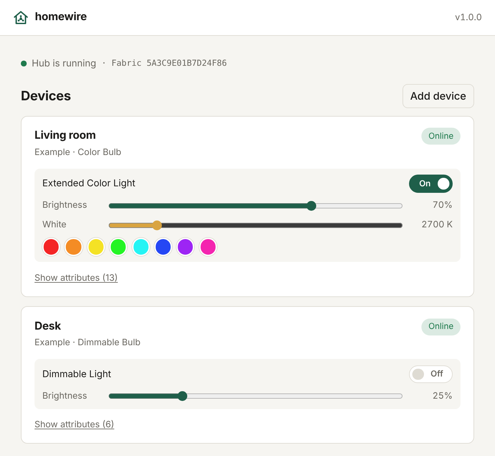

[](https://github.com/cybergarage/homewire/releases/latest) [](https://github.com/cybergarage/homewire/actions/workflows/ci.yml)

homewire is a Matter hub for the home network, built on [go-matter](https://github.com/cybergarage/go-matter). It adds Matter devices over Bluetooth or the network, and controls them from a web UI in the browser or an HTTP API. It runs as one executable, `homewire`, on a Linux host of the home network.



**The name.** homewire is *home* and *wire*: the wiring of a home. Like the wiring in its walls, the hub is what the devices of a home are connected through, out of sight, and the icon draws it so: a house, with the hub inside wired to its devices. The project was first named go-matter-hub; homewire is shorter, says what it is in plain English, and leaves out "Matter", a trademark of the CSA that many other projects carry in their names.

## Features

- **Devices, live.** The hub keeps a fabric of its own, connects to its devices at start, follows their state by subscription, and reconnects to a device it loses.
- **Control.** On/off, brightness, white color temperature and color, from the web UI or the API.
- **Adding devices** with their setup code (QR code or manual pairing code): a new device over Bluetooth, given the Wi-Fi network to join, or a device already on the network. The web UI shows each stage, and why a device could not join Wi-Fi.
- **Sharing with other apps** such as Google Home, Amazon Alexa or Apple Home, which then control a device alongside the hub (Matter multi-admin, verified with Google Home). A device another app shares can be added to the hub too.
- **Secure by default.** The hub listens on this host only; on the network, it requires its access token. `homewire open` signs a browser in without typing the token.
- **A .deb package** for amd64 and arm64: a hardened systemd service, and a launcher in the desktop's applications.

Not supported yet: Thread devices, automations, remote access and TLS in the hub itself.

homewire is for personal use on a home network you trust; it is not a certified commercial controller.

## Compatibility

| | Verified |
| --- | --- |
| Other apps (multi-admin) | Google Home, in both directions: a device shared from homewire, and one Google Home shares. Amazon Alexa, Apple Home, SmartThings and Home Assistant are not verified yet |
| Devices | Two Wi-Fi light bulbs of different vendors, added over Bluetooth and over the network |
| Hosts | Ubuntu 26.04 on an Intel PC (amd64); Raspberry Pi OS (64-bit) of 2026-10-06, Debian 13, on a Raspberry Pi 400 (arm64) |

## Install

The .deb packages are on the [releases page](https://github.com/cybergarage/homewire/releases) (Debian or Ubuntu with systemd). Download and install the one of this host's architecture:

```sh
cd /tmp                              # a directory apt's own user can read
VERSION=1.0.1
ARCH=$(dpkg --print-architecture)    # amd64 or arm64
curl -LO https://github.com/cybergarage/homewire/releases/download/v${VERSION}/homewire_${VERSION}_${ARCH}.deb
sudo apt install ./homewire_${VERSION}_${ARCH}.deb
```

The package starts the hub as the systemd service `homewire.service`. Let your user use it, then open the web UI:

```sh
sudo adduser $USER homewire    # then sign out and in again, or run: newgrp homewire
homewire status                # the hub and its devices
homewire open                  # the web UI in a browser, signed in
```

On a desktop, **homewire** in the applications (the app grid in GNOME) does the same as `homewire open`.

- **Other machines.** The hub listens on this host only. To use it from another machine, set `HOMEWIRE_LISTEN=0.0.0.0:8580` in `/etc/default/homewire` and run `sudo systemctl restart homewire`; there, sign in with the link of `homewire open -print`.
- **Bluetooth.** Adding a new device needs a Bluetooth adapter on the host; the package installs BlueZ. Most devices join a 2.4 GHz Wi-Fi network only.
- **Raspberry Pi.** Raspberry Pi OS blocks Bluetooth until it is unblocked: run `sudo rfkill unblock bluetooth`, then check that `bluetoothctl show` says `Powered: yes`. For Wi-Fi, set the country in `sudo raspi-config` (Localisation Options, WLAN Country).
- **Log.** `journalctl -u homewire -f`.
- **Remove.** `sudo apt remove homewire` keeps the hub's data in `/var/lib/homewire`; `sudo apt purge homewire` deletes it too, and the devices then have to be reset to factory defaults to be added again.

## Use

- **Add device** takes the device's setup code. A new device is found over Bluetooth and needs the name and password of the Wi-Fi network it is to join; a device already on the network, or shared by another app, is found there.
- **Share with another app…** on a device opens a pairing window for 10 minutes, and shows the QR code and setup code to add it in the other app.
- **Remove device…** makes the device leave the hub's fabric.

See [using homewire](docs/usage.md) for the details, such as a device which cannot be added again and what to do when a device does not recover after a Wi-Fi drop.

## Documentation

| Page | |
| --- | --- |
| [Using homewire](docs/usage.md) | The hub's fabric and its devices; adding, sharing and removing a device |
| [Commands and options](docs/configuration.md) | `homewire serve`, `open`, `status`, `token`, their options, and the system service |
| [Access control and signing in](docs/security.md) | The access token, browser sessions, `homewire open`, and what is not covered |
| [HTTP API](docs/api.md) | The API and its event stream, for scripts |
| [Development](docs/development.md) | Building from source, testing, and the layout of the repository |
| [CHANGELOG](CHANGELOG.md) | The changes of each release |

## Certification and trademarks

Matter is a trademark of the [Connectivity Standards Alliance](https://csa-iot.org/) (CSA). homewire is an independent open-source project: it is not affiliated with, endorsed by or certified by the CSA. A product built on it needs CSA membership and certification to be sold as a Matter product or to use the Matter name and logo.

The hub creates its fabric with the vendor ID 0xFFF1 by default (`-vendor-id`), a test vendor ID for development; a product uses the vendor ID the CSA assigned to its maker.

## License

Apache License 2.0. See [LICENSE](LICENSE). The executable includes third-party software: see [THIRD_PARTY_NOTICES.md](THIRD_PARTY_NOTICES.md), also installed in `/usr/share/doc/homewire`.
